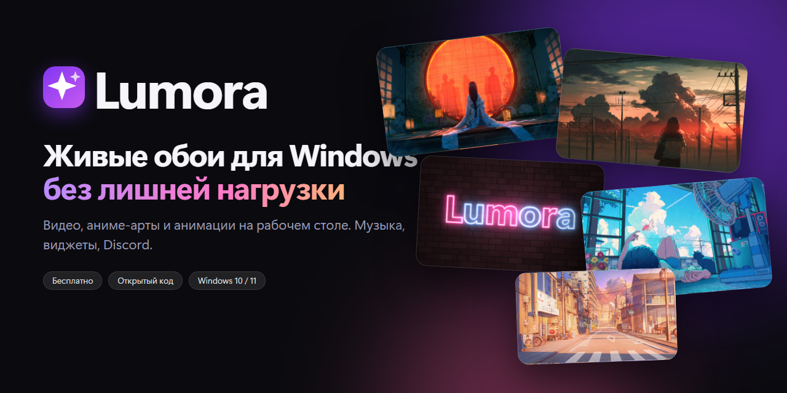

<div align="center">



# Lumora Packs

**Коллекции обоев для [Lumora](../../../Lumora): аниме-арты и видео 1080p.**
Отдельные установщики — ставите только то, что нужно.

[Скачать коллекции](../../releases/latest)

</div>

---

> ## ⚠️ Об авторских правах
> **Все арты и видео в этих коллекциях — не работа автора Lumora.** Они принадлежат своим создателям и приложены **только как пример того, что можно найти в интернете и поставить на рабочий стол** с помощью Lumora. Автор репозитория не претендует на права на них и ничего на них не зарабатывает. Используйте только в личных целях, не перепродавайте и не выдавайте за свои. Если вы автор работы и хотите, чтобы её убрали, — откройте issue, и она будет удалена в кратчайшие сроки.
>
> Сама Lumora (код) распространяется под лицензией MIT отдельно, эта лицензия **не** распространяется на материалы коллекций.

## Что внутри

| Установщик | Содержимое | Размер |
|---|---|---|
| `Lumora-AnimeArts.exe` | **50 «живых артов»**: аниме-картинки, которые оживают — двигаются за курсором, поверх частицы и блики | ≈ 120 МБ |
| `Lumora-Videos-Anime-1.exe` … `-4.exe` | **151 видео-обой** с аниме, 1080p, 4 части | ≈ 400 + 400 + 400 + 220 МБ |
| `Lumora-Videos-Games.exe` | **24 видео** по играм: Genshin, Minecraft, Cyberpunk, Valorant и др. | ≈ 260 МБ |
| `Lumora-Videos-Movies-Memes.exe` | **24 видео**: мультфильмы, сериалы и «мемные» коллекции | ≈ 180 МБ |
| `Lumora-Videos-Cars.exe` | **10 видео** с автомобилями | ≈ 95 МБ |
| `Lumora-Videos-Nature-Space.exe` | **14 видео**: природа, дождь, закаты, космос | ≈ 145 МБ |

Всего: **273 обоев** (50 артов + 223 видео), около 2,2 ГБ. Скачивать можно любые части отдельно.

## Как установить

1. Установите [Lumora](../../../Lumora/releases/latest).
2. Скачайте нужные установщики со страницы [Releases](../../releases/latest).
3. Запустите — установщик сам найдёт папку библиотеки Lumora (`%LOCALAPPDATA%\LiveWall\Library`), закроет приложение, скопирует файлы и запустит Lumora обратно. Путь можно поменять кнопкой «Обзор».
4. Новые обои появятся в библиотеке: арты и видео — в коллекции «Аниме», «Игры», «Кино и мемы» и т.д.

Тихая установка: `Lumora-Videos-Cars.exe /S`.

### Установка вручную
Если не хочется запускать exe: установщик — это обычный архив внутри. Можно просто положить свои файлы в `%LOCALAPPDATA%\LiveWall\Library`: картинки, GIF и видео подхватятся автоматически (кнопка «Добавить» в Lumora делает то же самое).

## Контрольные суммы

В релизе лежит файл `SHA256SUMS.txt`. Проверить: `Get-FileHash .\Lumora-Videos-Cars.exe -Algorithm SHA256`.

> Установщики не подписаны, поэтому Windows SmartScreen может показать «Неопознанный издатель» — это нормально для проектов без платной подписи.

## Откуда это

Видео-обои и арты подобраны с открытых интернет-каталогов (в основном motionbgs.com; арты — wallhaven.cc) для личного использования как демонстрация возможностей Lumora. Если хотите собрать свою коллекцию — в основном репозитории есть пример скрипта `tools/videos.js`, а новые видео и картинки можно добавлять просто перетаскиванием в окно Lumora.

## Как собрать свои коллекции

```powershell
# в репозитории Lumora, после того как в библиотеке есть нужные файлы:
powershell -ExecutionPolicy Bypass -File tools\make-packs.ps1 -PartMB 400
```

Скрипт разделит видео на части по группам (до ~400 МБ, лимит файла на GitHub — 2 ГБ) и положит `*.exe` в `dist\packs`.

---

<div align="center">Создал <b>Frein</b> ❤ · <a href="../../../Lumora">Lumora</a></div>
